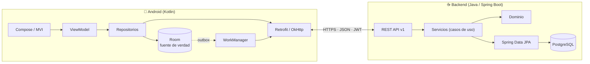
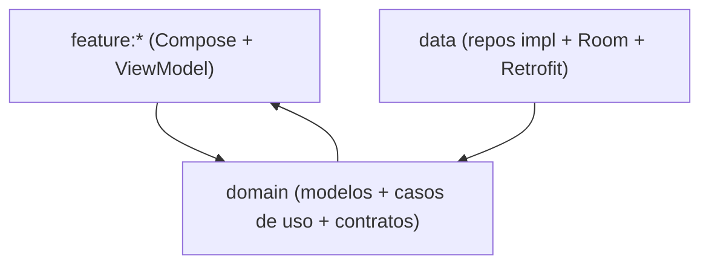
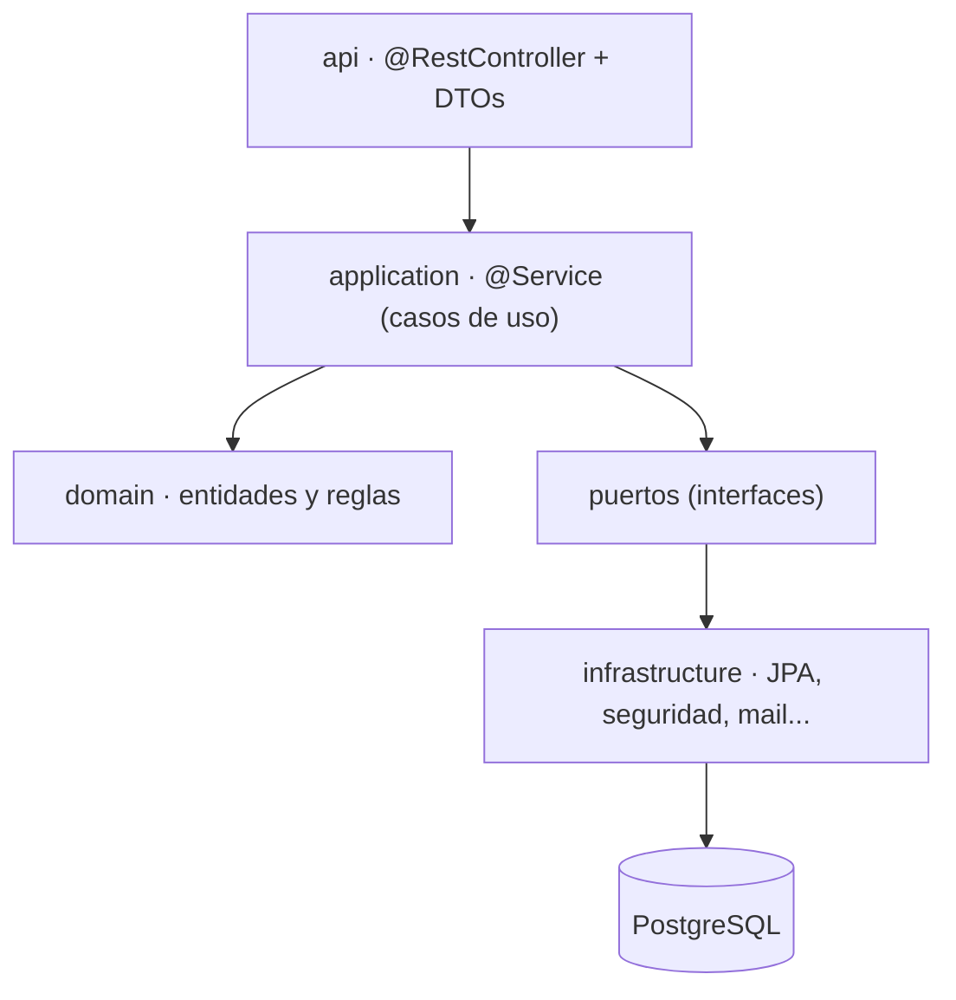
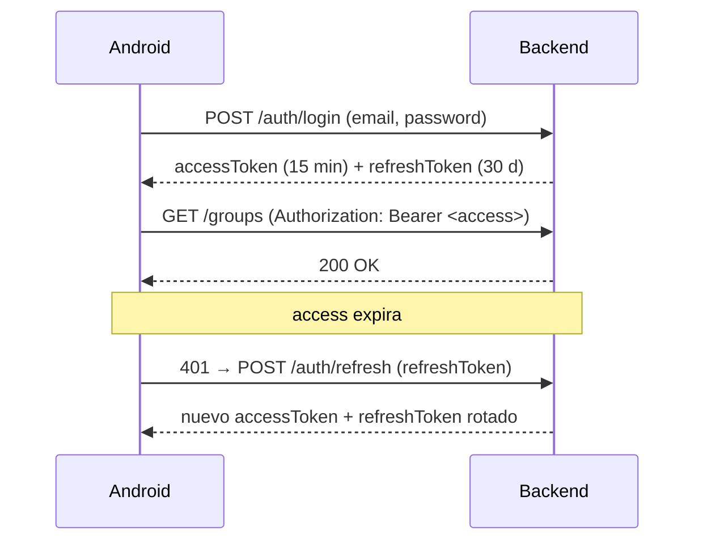

# 02 · Arquitectura

## 1. Visión general

Dos aplicaciones independientes que se comunican por **HTTPS/JSON** mediante un contrato **OpenAPI**:

**Principio rector:** el backend es la autoridad de los datos; el cliente mantiene una **caché** en Room para arrancar rápido y funcionar (al menos en lectura) sin red.

## 2. Cliente Android (resumen)

Arquitectura **Clean + MVI**, en módulos Gradle (detalle en `06-arquitectura-android.md`):

- **UI**: `UiState` inmutable por pantalla, eventos `onX()` hacia el ViewModel, efectos one-shot por `Channel`.
- **Dominio**: modelos puros (`Money`, `Expense`, `Group`...), casos de uso, interfaces de repositorio.
- **Datos**: implementación de repositorios, `Room` (entidades + DAO + mappers) y `Retrofit` (DTOs + mappers).
- **Offline-first**: Room es la fuente de verdad; la red *hidrata* la caché. Las mutaciones offline van a una tabla `outbox` que WorkManager reintenta.

## 3. Backend (resumen)

Arquitectura **en capas** dentro de un único servicio (detalle en `07-arquitectura-backend.md`):

- **api**: controllers finos, validación de entrada, mapeo DTO↔dominio, manejo global de errores.
- **application**: orquestación transaccional y **autorización por recurso** (¿es miembro del grupo? ¿es admin?).
- **domain**: entidades, objetos de valor (`Money`, `SplitInstruction`) y el **servicio de liquidación**.
- **infrastructure**: repositorios JPA, seguridad (JWT), migraciones Flyway.

## 4. Autenticación y autorización

- **Access token**: JWT firmado (RS256), vida corta, stateless. Claims: `sub` (userId), `exp`, `iat`, `jti`.
- **Refresh token**: opaco/aleatorio, se guarda **hasheado** en `refresh_tokens`; **rota** en cada uso y revoca el anterior (detección de reuso).
- **Autorización**: por **recurso** — cada operación sobre un grupo verifica la membresía y el rol del usuario autenticado.

## 5. Modelo offline-first y sincronización

Estrategia *network-bound + write-behind* para el MVP:

| Operación | Comportamiento |
|---|---|
| **Lectura** | Sirve de Room; `RemoteMediator` refresca en segundo plano y pagina |
| **Escritura online** | Llama a la API; al `2xx`, actualiza Room |
| **Escritura offline** | Inserta en `outbox` → la UI optimista; WorkManager reintenta con `Idempotency-Key` |

**Resolución de conflictos:** bloqueo optimista por `version`. Si el servidor detecta versión desactualizada, responde `409 Conflict` y el cliente decide (recargar o reintentar).

## 6. Entornos

| Entorno | Backend | Base de datos | Cliente |
|---|---|---|---|
| **Local** | `docker-compose up` (API + Postgres) | Postgres en contenedor | Emulador apuntando a `10.0.2.2:8080` |
| **CI** | Se construye y testea (Testcontainers) | Postgres efímero | Gradle `test` + `lint` + `detekt` |
| **Demo** | Opcional: contenedor en un VPS/Render/Fly.io | Postgres gestionado | APK de release firmado |

## 7. Seguridad de extremo a extremo

- HTTPS obligatorio (HSTS en producción).
- Contraseñas con `BCrypt` (coste ≥ 10); nunca se registran en logs.
- Tokens en el cliente con **almacenamiento cifrado** (Jetpack Security / `EncryptedSharedPreferences` o DataStore cifrado).
- Validación de entrada en API + restricciones en base de datos (defensa en profundidad).
- Rate limiting en `/auth/*`; CORS cerrado (clientes móviles no lo necesitan).
- Cabeceras: `X-Content-Type-Options`, `X-Frame-Options`, `Content-Security-Policy` (para Swagger).

## 8. Observabilidad

- **Logs** estructurados (JSON) con `correlationId` propagado desde el header `X-Request-Id`.
- **Métricas**: Spring Actuator + Micrometer (latencia, errores, pool de conexiones).
- **Health**: `/actuator/health` (liveness/readiness) para el orquestador.

## 9. Riesgos técnicos y mitigaciones

| Riesgo | Mitigación |
|---|---|
| Redondeo al dividir importes (%) | Repartir el **resto** a las primeras partes (regla determinista), validado por invariante |
| Bucles/orfandad en saldos | Los balances siempre se **derivan**; no se almacenan como verdad editable |
| Complejidad del offline | Empezar online-only, añadir outbox en la fase 8 |
| Cambios de contrato rompen el cliente | Versión en la URL (`/api/v1`) + generación de DTOs desde OpenAPI |
