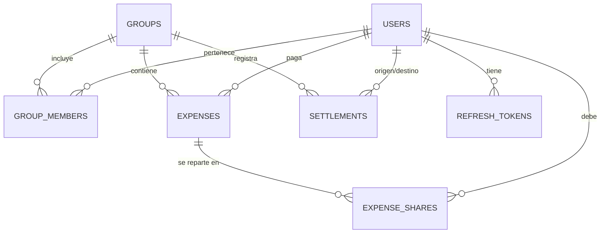

# 03 · Modelo de datos

## 1. Diagrama entidad-relación

## 2. Convenciones

- **Claves primarias**: `UUID` (`uuid` en Postgres), generadas en la aplicación.
- **Dinero**: `BIGINT` en **unidades mínimas** (céntimos). Nunca `float`/`double`. Ver [ADR-0001](adr/0001-dinero-como-enteros.md).
- **Fechas/horas**: `timestamptz` (UTC). Fechas de negocio (p. ej. `expense_date`): `date`.
- **Concurrencia**: columna `version BIGINT` para bloqueo optimista en entidades editables.
- **Borrado lógico**: `deleted_at timestamptz NULL` en `expenses`, `settlements` y `groups`.
- **Nomenclatura**: `snake_case`, tablas en plural.

## 3. Tablas

### 3.1 `users`
| Columna | Tipo | Restricciones |
|---|---|---|
| `id` | uuid | PK |
| `email` | citext | UNIQUE, NOT NULL |
| `password_hash` | text | NOT NULL |
| `display_name` | text | NOT NULL |
| `default_currency` | char(3) | NOT NULL, default `'EUR'` |
| `locale` | varchar(10) | NULL |
| `created_at` | timestamptz | NOT NULL |
| `updated_at` | timestamptz | NOT NULL |
| `version` | bigint | NOT NULL, default 0 |

> `citext` requiere `CREATE EXTENSION citext;` (lo gestiona la migración Flyway inicial).

### 3.2 `groups`
| Columna | Tipo | Restricciones |
|---|---|---|
| `id` | uuid | PK |
| `name` | text | NOT NULL |
| `description` | text | NULL |
| `currency` | char(3) | NOT NULL |
| `created_by` | uuid | FK → `users.id` |
| `invite_code` | text | UNIQUE, NOT NULL |
| `archived_at` | timestamptz | NULL |
| `deleted_at` | timestamptz | NULL |
| `created_at` / `updated_at` | timestamptz | NOT NULL |
| `version` | bigint | NOT NULL, default 0 |

### 3.3 `group_members`
| Columna | Tipo | Restricciones |
|---|---|---|
| `id` | uuid | PK |
| `group_id` | uuid | FK → `groups.id`, ON DELETE CASCADE |
| `user_id` | uuid | FK → `users.id` |
| `role` | varchar(16) | `OWNER` \| `ADMIN` \| `MEMBER` |
| `status` | varchar(16) | `INVITED` \| `ACTIVE` \| `LEFT` |
| `joined_at` | timestamptz | NULL |
| `created_at` | timestamptz | NOT NULL |

**Índices y restricciones**
- `UNIQUE (group_id, user_id)`.
- `INDEX (user_id)` — "mis grupos".

### 3.4 `expenses`
| Columna | Tipo | Restricciones |
|---|---|---|
| `id` | uuid | PK |
| `group_id` | uuid | FK → `groups.id` |
| `description` | text | NOT NULL |
| `amount_minor` | bigint | NOT NULL, CHECK > 0 |
| `currency` | char(3) | NOT NULL |
| `paid_by_user_id` | uuid | FK → `users.id` |
| `split_type` | varchar(16) | `EQUAL` \| `EXACT` \| `PERCENTAGE` \| `SHARES` |
| `category` | varchar(32) | NULL |
| `expense_date` | date | NOT NULL |
| `notes` | text | NULL |
| `created_by` | uuid | FK → `users.id` |
| `created_at` / `updated_at` | timestamptz | NOT NULL |
| `deleted_at` | timestamptz | NULL |
| `version` | bigint | NOT NULL, default 0 |

**Índices**
- `INDEX (group_id, expense_date DESC, id DESC)` — paginación por cursor.
- `INDEX (paid_by_user_id)`.

### 3.5 `expense_shares`
Representa **cómo se reparte** un gasto. Siempre se persiste el importe **resuelto** (`share_minor`), además del parámetro configurado (`weight`/`percentage`), para simplificar el cálculo de balances y hacerlo auditable.

| Columna | Tipo | Restricciones |
|---|---|---|
| `id` | uuid | PK |
| `expense_id` | uuid | FK → `expenses.id`, ON DELETE CASCADE |
| `user_id` | uuid | FK → `users.id` |
| `share_minor` | bigint | NOT NULL, CHECK >= 0 — importe **resuelto** |
| `weight` | numeric(12,4) | NULL — para `SHARES` |
| `percentage` | numeric(7,4) | NULL — para `PERCENTAGE` |
| `created_at` | timestamptz | NOT NULL |

**Índices y restricciones**
- `UNIQUE (expense_id, user_id)`.
- `INDEX (user_id)` — "lo que debo".

**Invariante (clave):** `SUM(share_minor) = expenses.amount_minor`. Se valida en la capa de aplicación y, como red de seguridad, mediante un trigger o `CHECK` diferido.

### 3.6 `settlements`
Pagos reales entre miembros (una persona le devuelve dinero a otra).

| Columna | Tipo | Restricciones |
|---|---|---|
| `id` | uuid | PK |
| `group_id` | uuid | FK → `groups.id` |
| `from_user_id` | uuid | FK → `users.id` (quien paga) |
| `to_user_id` | uuid | FK → `users.id` (quien recibe) |
| `amount_minor` | bigint | NOT NULL, CHECK > 0 |
| `currency` | char(3) | NOT NULL |
| `settled_on` | date | NOT NULL |
| `note` | text | NULL |
| `created_by` | uuid | FK → `users.id` |
| `created_at` | timestamptz | NOT NULL |
| `deleted_at` | timestamptz | NULL |

**Índices:** `INDEX (group_id, settled_on DESC)`.

### 3.7 `refresh_tokens`
| Columna | Tipo | Restricciones |
|---|---|---|
| `id` | uuid | PK |
| `user_id` | uuid | FK → `users.id`, ON DELETE CASCADE |
| `token_hash` | text | NOT NULL, UNIQUE |
| `expires_at` | timestamptz | NOT NULL |
| `revoked_at` | timestamptz | NULL |
| `replaced_by_id` | uuid | NULL — encadenado de rotación |
| `user_agent` | text | NULL |
| `ip` | inet | NULL |
| `created_at` | timestamptz | NOT NULL |

### 3.8 `idempotency_keys`
| Columna | Tipo | Restricciones |
|---|---|---|
| `key` | text | PK |
| `user_id` | uuid | FK → `users.id` |
| `endpoint` | text | NOT NULL |
| `request_hash` | text | NOT NULL |
| `response_status` | int | NULL |
| `response_body` | jsonb | NULL |
| `created_at` | timestamptz | NOT NULL |

**Índice:** `UNIQUE (user_id, key)`; purga de claves de más de 24 h.

## 4. Balances: ¿tabla o cálculo?

**Decisión: se calculan, no se almacenan como verdad.** La fuente de verdad son `expenses + expense_shares + settlements`.

- `neto(u) = Σ(gastos pagados por u) − Σ(partes de u) + Σ(liquidaciones que u pagó) − Σ(liquidaciones que u recibió)`
- La suma de todos los netos de un grupo es **siempre 0** (buena prueba de sanidad).

Opcional (optimización futura): una **vista materializada** o caché `group_balances` refrescada al modificar gastos/liquidaciones. No forma parte del MVP.

## 5. Ejemplo de reparto no equitativo

Gasto de `30,00 €` pagado por Ana, repartido al 50 % entre Ana, Luis y Marta (3 personas → 16,67 % cada una). Como el porcentaje no cuadra de forma exacta:

- Resolución: se calcula `floor` de cada parte y el **resto** (céntimos sobrantes) se reparte a las primeras partes de forma determinista (orden por `user_id`).
- Resultado posible: `10,00 + 10,00 + 10,00` si el total es divisible; en caso contrario, las partes difieren en 1 céntimo.
- La invariante `Σ share_minor = amount_minor` **nunca** se rompe.

Ver `05-algoritmo-liquidacion.md` para el detalle del reparto y del settlement.

## 6. Migraciones

Todas las tablas se crean con **Flyway** (`V1__init.sql`, `V2__groups.sql`, ...). El esquema de producción **nunca** se crea con `ddl-auto=update`. Palabras clave reservadas (`groups`): si el motor lo requiere, se cita el identificador.
