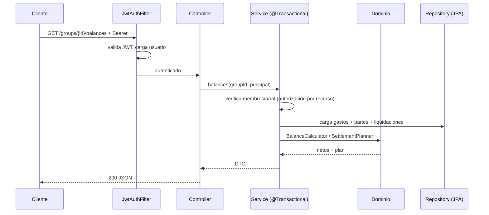

# 07 · Arquitectura Backend

Un único servicio **Spring Boot** (Java 17) con arquitectura **en capas / hexagonal ligera**, PostgreSQL y seguridad JWT.

## 1. Estructura de paquetes

```
backend/src/main/java/app/cuentasclaras/
├── api/                     # entrada HTTP
│   ├── controller/          # AuthController, GroupController, ExpenseController...
│   ├── dto/                 # request/response (@Valid) con mappers estáticos from(...)
│   └── error/               # @ControllerAdvice -> RFC 7807
├── application/             # casos de uso (@Service, @Transactional)
│   ├── auth/
│   ├── group/
│   ├── expense/
│   ├── idempotency/
│   ├── common/              # CursorCodec
│   ├── balance/
│   ├── settlement/
│   └── activity/            # ActivityRecorder (escribe) + ActivityService (feed)
├── domain/                  # lógica pura, sin Spring
│   ├── model/               # User, Group, Expense, Money, Split...
│   ├── service/             # SplitCalculator, SettlementPlanner
│   └── repository/          # interfaces (puertos)
└── infrastructure/          # adaptadores
    ├── persistence/         # entidades JPA, repos Spring Data, mappers
    ├── security/            # JWT, filtros, UserDetails
    ├── config/              # SecurityConfig, OpenApiConfig, JacksonConfig
    └── mail/ (futuro)
```

**Regla:** `domain` no importa Spring ni JPA. La lógica de reparto y liquidación vive aquí y se testea sin contexto.

## 2. Flujo de una petición



## 3. Seguridad

- **Spring Security** en modo *stateless* (`SessionCreationPolicy.STATELESS`).
- **JWT** firmado con clave asimétrica **RS256**; el filtro valida firma y expiración y puebla el `SecurityContext`.
- **Contraseñas**: `BCryptPasswordEncoder` (strength 10+).
- **Refresh tokens** opacos, hasheados en `refresh_tokens`, con **rotación** y detección de reuso (revoca toda la cadena si se reutiliza uno antiguo).
- **Autorización por recurso**: un `GroupAccessGuard` (o métodos en los servicios) comprueba membresía y rol antes de cada operación. No se usan simplemente roles globales.
- **Rate limiting** en `/auth/*` (Bucket4j o filtro propio) para mitigar fuerza bruta.
- **Validación** de entrada con Bean Validation; restricciones también en la BD.

### Propiedades del token
| Token | Formato | Vida | Revocable | Almacenamiento |
|---|---|---|---|---|
| Access | JWT RS256 | 15 min | No (corto) | Cliente (cifrado) |
| Refresh | Opaco (256 bits) | 30 días | **Sí** | Hash en `refresh_tokens` |

## 4. Persistencia

- **Spring Data JPA + Hibernate**, PostgreSQL.
- Entidades JPA separadas de los modelos de dominio (mappers explícitos).
- **Flyway** para migraciones versionadas (`V1__...`, `V2__...`). `ddl-auto = validate` en producción.
- **Bloqueo optimista**: `@Version` en `Expense` y `Group`. Los pagos (`settlements`) son registros inmutables: no llevan `version` (solo borrado lógico).
- **Transacciones**: límite transaccional en la capa `application` (no en controllers ni repos).
- **N+1**: `JOIN FETCH` / `EntityGraph` en consultas de detalle; DTOs *projection* para listados.

## 5. Errores

`@RestControllerAdvice` (`GlobalExceptionHandler`) traduce excepciones a **RFC 7807**.
Los códigos viven en el enum `ErrorCode` (código → HTTP + título):

| Excepción | HTTP | `code` (ejemplos) |
|---|---|---|
| `ApiException(ErrorCode)` | según el código | `NOT_MEMBER`, `INVALID_PARTICIPANT`, `EXPENSE_NOT_FOUND`, `CONFLICT`… |
| `SplitValidationException` | 422 | `SPLIT_MISMATCH`, `PERCENTAGE_SUM` |
| `MethodArgumentNotValidException` | 400 | `VALIDATION_ERROR` |
| `OptimisticLockingFailureException` | 409 | `CONFLICT` |
| `DataIntegrityViolationException` | 409 | `CONFLICT` |

## 6. Idempotencia

Implementada en `IdempotencyService` con el flujo **reservar → ejecutar → completar**
(no un interceptor genérico, por simplicidad y transparencia):

1. Si viene `Idempotency-Key`, se busca `(user_id, key)`.
2. Si existe con el mismo `request_hash` → se devuelve la respuesta guardada.
3. Si existe con hash distinto → `409`.
4. Si no existe → se **reserva** la clave, se ejecuta y se guarda la respuesta.
5. Si la operación falla, se libera la reserva (permite reintentar).

## 7. Observabilidad

- **Actuator**: `/actuator/health`, `/metrics`, `/info`.
- **Micrometer**: latencia por endpoint, tasa de error, uso del pool.
- **Logs** JSON con `correlationId` (del header `X-Request-Id`, propagado con MDC).
- **Swagger UI** (`springdoc`) para explorar el contrato en local.

## 8. Testing

| Nivel | Herramientas | Qué cubre |
|---|---|---|
| Unitario (dominio) | JUnit 5 + AssertJ | `SplitCalculator`, `BalanceCalculator`, `SettlementPlanner` |
| Unitario (servicios) | JUnit 5 + **Mockito** | reglas de negocio y autorización |
| Integración | **Testcontainers (PostgreSQL)** + `@SpringBootTest` | repos, transacciones, migraciones |
| Web | `MockMvc` / `WebTestClient` + `@WithMockUser` | controllers, validación, seguridad, errores |
| Contrato | Validación de `openapi.yaml` | el contrato sigue siendo válido |

## 9. Despliegue

```yaml
# infra/docker-compose.yml (esquema)
services:
  db:
    image: postgres:16
    environment: [POSTGRES_DB, POSTGRES_USER, POSTGRES_PASSWORD]
    volumes: [ "pgdata:/var/lib/postgresql/data" ]
  api:
    build: ./backend
    depends_on: [db]
    environment:
      SPRING_DATASOURCE_URL: jdbc:postgresql://db:5432/cuentas_claras
      SPRING_PROFILES_ACTIVE: docker
    ports: [ "8080:8080" ]
```

- **Perfiles** Spring: `dev` (por defecto, H2), `docker` (PostgreSQL) y `test` (Testcontainers).
- Secretos por variables de entorno (nunca en el repo).
- Imagen Docker multi-stage (build con JDK, runtime con JRE *slim*).
- En CI: build + `test` (con Testcontainers) + validación de OpenAPI.

## 10. Decisiones de rendimiento

- Paginación por cursor (evita `OFFSET` profundo).
- Índices alineados con las consultas (ver `03-modelo-de-datos.md`).
- Cálculo de balances en memoria a partir de conjuntos ya filtrados por grupo; para grupos muy grandes, agregados SQL (`SUM ... GROUP BY`).
- Endpoints de solo lectura marcados `@Transactional(readOnly = true)`.
