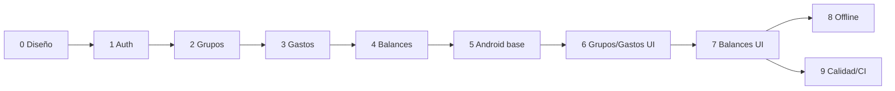

# 08 · Plan por fases

Roadmap incremental. Cada fase termina con **algo verificable** y criterios de aceptación claros.
Estado: **fases 0–9 completadas**.

---

## Fase 0 · Diseño (completada)
**Objetivo:** definir el producto y la ingeniería antes de escribir código.
**Entregables:** visión y alcance, arquitectura, modelo de datos, contrato OpenAPI, algoritmo de liquidación, arquitecturas de cliente y backend, ADRs.
**Criterios de aceptación:**
- [x] `openapi.yaml` describe todos los endpoints del MVP.
- [x] El modelo de datos cubre auth, grupos, gastos, repartos y liquidaciones.
- [x] El algoritmo de liquidación está definido con pseudocódigo y casos de prueba.
- [x] Existen ADRs para las decisiones clave.

---

## Fase 1 · Backend base + autenticación (completada)
**Objetivo:** API que levanta, migra y autentica.
**Entregables:**
- [x] Proyecto Spring Boot (Java 17) + `docker-compose` (Postgres + API).
- [x] Flyway `V1__init_users.sql`, `V2__refresh_tokens.sql`.
- [x] Endpoints `register`, `login`, `refresh`, `logout`, `GET/PATCH /users/me`.
- [x] Seguridad JWT (RS256) + refresh rotativo + `@ControllerAdvice` RFC 7807.
- [x] Swagger UI.
**Criterios de aceptación:**
- [x] `docker-compose up` → `/actuator/health` = `UP`.
- [x] Registro/login/refresh funcionan; un token caducado devuelve `401`; refresh rota y revoca.
- [x] Tests de integración (Testcontainers) en verde para auth.
**Nota:** la suite de Testcontainers (`AuthApiPostgresTest`, `@Testcontainers(disabledWithoutDocker = true)`) se
omite automáticamente cuando no hay Docker; sin Docker los tests de integración corren contra H2 (perfil `test`).

---

## Fase 2 · Grupos y miembros (completada)
**Objetivo:** espacios compartidos con roles e invitaciones.
**Entregables:**
- [x] `V3__groups.sql`, `V4__group_members.sql`.
- [x] CRUD de grupos, listado "mis grupos" (paginado por cursor), miembros, roles, invitaciones.
- [x] `GroupAccessGuard` (autorización por recurso).
**Criterios de aceptación:**
- [x] Solo miembros ven el grupo; solo owner/admin gestionan.
- [x] Un no-miembro recibe `403 NOT_MEMBER`.
- [x] No se puede quitar al último `OWNER` (`409 LAST_OWNER`).

---

## Fase 3 · Gastos y repartos (completada)
**Objetivo:** registrar y listar gastos con los 4 tipos de reparto.
**Entregables:**
- [x] `V5__expenses.sql`, `V6__expense_shares.sql`, `V7__idempotency_keys.sql`.
- [x] `SplitCalculator` en `domain` (EQUAL/EXACT/PERCENTAGE/SHARES) + `SplitValidationException`.
- [x] CRUD de gastos + listado paginado por cursor con filtros (`from`, `to`, `paidByUserId`, `category`).
- [x] Idempotencia en `POST /expenses` (`Idempotency-Key`: reservar → ejecutar → completar).
**Criterios de aceptación:**
- [x] `Σ share_minor = amount_minor` siempre; violaciones → `422` (`SPLIT_MISMATCH` / `PERCENTAGE_SUM`).
- [x] Reintentar un `POST` con la misma `Idempotency-Key` no duplica el gasto (y `409` si cambia el cuerpo).
- [x] Golden tests del reparto (incluido el reparto de resto) en verde.

---

## Fase 4 · Balances y plan de liquidación (completada)
**Objetivo:** el valor diferencial del producto.
**Entregables:**
- [x] `BalanceCalculator` (netos + pares).
- [x] `SettlementPlanner` (greedy, y exacto para `n ≤ 12`).
- [x] Endpoints `GET /balances` y `GET /settlement-plan`.
- [x] Registro y listado de `settlements` (`V8__settlements.sql`, `Idempotency-Key` en el POST).
- [x] Feed de actividad del grupo (`GET /groups/{id}/activity`, `V9__activity_events.sql`, UC-08).
**Criterios de aceptación:**
- [x] `Σ netos = 0` en todos los casos de prueba.
- [x] El plan salda todas las deudas (se puede verificar aplicándolo).
- [x] Tests unitarios y de propiedad (random) del plan.
- [x] El feed registra gastos, pagos y altas/bajas de miembros, ordenado y paginado por cursor.

---

## Fase 5 · Android: base (completada)
**Objetivo:** esqueleto multi-módulo funcional con auth.
**Entregables:**
- [x] Módulos Gradle (`core/*`, `domain`, `data`, `feature/auth`, `app`).
- [x] Hilt + `DispatchersModule` + `NetworkModule` + `DatabaseModule`.
- [x] Retrofit + interceptores (auth, idempotencia) + almacenamiento cifrado de tokens.
- [x] Pantalla de login/registro con MVI + navegación raíz.
**Criterios de aceptación:**
- [x] Login real contra el backend, token guardado cifrado, sesión persistente.
- [x] Al expirar el access, el refresh se ejecuta de forma transparente.
- [x] Tests de ViewModel (Turbine) y de red (MockWebServer).
**Verificación:**
- `:app:assembleDebug` y `:app:assembleRelease` compilan.
- 26 tests unitarios en verde (`domain`, `core:network`, `data`, `feature/auth`).
- Test instrumentado end-to-end contra backend real (`AuthEndToEndTest`): registro → restauración de sesión → logout → login → mapeo de `401`.

---

## Fase 6 · Android: grupos y gastos (completada)
**Objetivo:** flujo principal de la app.
**Entregables:**
- `feature/groups` y `feature/expenses`.
- Listado paginado (Paging 3 + `RemoteMediator`), detalle, crear/editar gasto con los 4 repartos.
- Caché en Room como fuente de verdad.
**Criterios de aceptación:**
- Los datos sobreviven a cerrar la app (Room) y se refrescan con la red.
- Crear/editar/borrar gasto se refleja tras el siguiente sync.

---

## Fase 7 · Android: balances y liquidación (completada)
**Objetivo:** visualizar deudas y saldarlas.
**Entregables:**
- [x] `feature/balances`: netos, pares y **plan de liquidación**.
- [x] Registrar un pago desde la sugerencia (formulario prerrellenado + `POST` idempotente).
- [x] Gráficos/estados vacíos y de error.
- [x] Historia de pagos paginada por cursor (`GET /groups/{id}/settlements`).
**Criterios de aceptación:**
- [x] Coincide con el backend (mismos números).
- [x] Registrar un pago actualiza los balances.
**Verificación:**
- `:app:assembleDebug`, `:app:lintDebug` y `:app:assembleDebugAndroidTest` compilan.
- 63 tests unitarios en verde (dominio, `core:network`, `data`, `feature/*`), incluidos `BalancesViewModelTest`, `SettlementFormViewModelTest`, `SettlementHistoryViewModelTest`, `SettlementPagingSourceTest` y `BalancesApiTest`.
- Test instrumentado end-to-end contra backend real (`BalancesEndToEndTest`): gasto a medias → netos y pares del backend → registrar el pago sugerido → balances a cero.

---

## Fase 8 · Offline-first y sincronización (completada)
**Objetivo:** uso sin conexión (stretch, tras cerrar el MVP online).
**Entregables:**
- [x] Tabla `outbox` + `SyncWorker` (WorkManager) con backoff.
- [x] Escritura optimista y drenado del outbox con `Idempotency-Key`.
- [x] Manejo de `409` (conflicto de versión) en UI.
**Criterios de aceptación:**
- [x] Crear un gasto sin red → aparece en UI y se sincroniza al recuperar conexión.
- [x] Sin duplicados tras reintentos.
**Verificación:**
- `:app:assembleDebug`, `:app:lintDebug` y `:app:assembleDebugAndroidTest` compilan.
- Migración Room 3 → 4 (tabla `outbox` + columna `expenses.pendingOperation`) cubierta en `DatabaseMigrationTest`.
- 277 tests unitarios en verde (35 suites), incluidos `ExpenseRepositoryImplTest` (escritura optimista y encolado),
  `OutboxDrainerTest` (alta/edición/baja, reintento transitorio, fallo definitivo y conflicto `409`), `SyncSchedulerTest`
  y `ExpensesListViewModelTest` (fallos de sincronización y reintento). `ExpenseRemoteMediatorTest` comprueba que un
  refresco remoto no borra ni sobrescribe los gastos aún pendientes de sincronizar.
- Alcance: la escritura optimista cubre el CRUD de **gastos**; balances, plan de liquidación e historia de pagos siguen
  leyéndose online.
**Nota:** un alta sin red se encola con el `id` de su fila del outbox como `Idempotency-Key`, y el drenado sustituye el
gasto optimista por el del servidor, de modo que reintentar no duplica. Un conflicto de versión en una edición recarga la
versión vigente del servidor y se señala en la UI para reintentar.

---

## Fase 9 · Calidad, CI y publicación (completada)
**Objetivo:** proyecto presentable y mantenible.
**Entregables:**
- [x] CI para backend (build + tests + Testcontainers + validación OpenAPI) y para Android (`test`, `lint`, `detekt`).
- [x] Contrato `openapi.yaml` como fuente de verdad: se valida en CI y `OpenApiContractTest` (Android) comprueba que
  los DTO no se desvían. Los DTO se mantienen a mano (no se genera código) por decisión de riesgo/beneficio.
- [x] README con arquitectura, instrucciones de ejecución y `docker-compose`.
- [x] Release de APK firmado (config de signing local + `release.yml` con secrets).
**Criterios de aceptación:**
- [x] Pipelines de backend y Android definidos; se verifican ejecutando sus mismos comandos en local.
- [x] Un clon nuevo se levanta y se prueba siguiendo el README.
**Verificación:**
- `detekt` (config en `android/detekt.yml`), `:app:lintDebug`, `:app:assembleDebug` y `:app:assembleRelease`
  terminan en verde.
- 282 tests unitarios en verde (36 suites): 215 en los módulos Android + 67 en `domain`, incluido
  `OpenApiContractTest` (campos obligatorios, campos desconocidos, esquemas sin mapear y enums de dominio).
- 7 tests instrumentados E2E en verde (`Auth`, `Groups`, `Expenses`, `Balances`) contra backend + emulador.
- `backend-ci.yml` ejecuta `./mvnw verify` (H2 + Testcontainers) y valida el OpenAPI con `swagger-cli`;
  `android-ci.yml` ejecuta `detekt`, `lintDebug`, `test` y `assembleDebug`; `release.yml` firma APK/AAB con secrets.
- Correcciones de calidad descubiertas al ejecutar los E2E: `ExpenseRemoteMediator` ya no pisa escrituras
  optimistas pendientes; `current_user` deja una sola fila al cambiar de sesión; el algoritmo del plan usa el valor
  real del backend (`EXACT`).
**Nota:** las capturas/GIF del README quedan como mejora pendiente (requieren grabar la app en marcha).

---

## Orden recomendado y dependencias

**Regla práctica:** no empezar la UI de una feature antes de que su API esté estable y con tests. Así el cliente se apoya en un contrato fiable.
